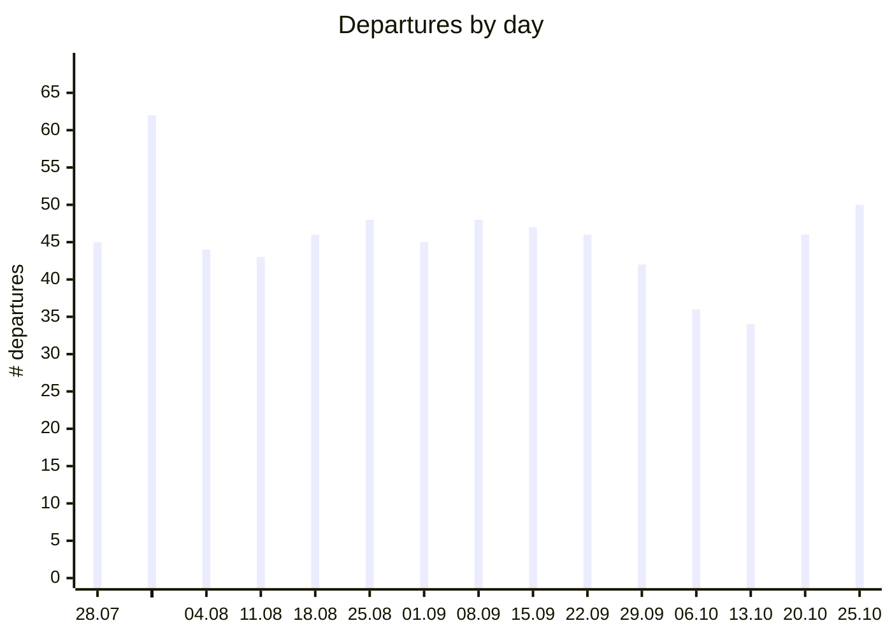

# tll-airport-departures

Tracking departures from Tallinn Airport. Data and graphs are updated daily.

I created this repo to:
- Test how to use Mermaid charting functions for basic reporting
- Test how to use Github Actions for scheudling basic data pipelines and transformations
- Find out where we can fly to from Tallinn

## Trend of Daily Departures

Last 90 days. One bar per day.



## Departures by quarter

Full history. Bars are the average departures per day. The line is the average number of destinations per day.


## Passengers in the terminal

Hour-by-hour forecast. Quiet, steady, busy, or crowded. Each flight is spread across the two hours before departure, and holiday flights count for more.

**2026-10-25**

| Hour | Terminal | Why |
| --- | --- | --- |
| 04:00 | busy | 13 flights, 4 charters (Antalya, Heraklion, Sharm El Sheikh +1) |
| 05:00 | busy | 11 flights, 4 charters (Antalya, Heraklion, Sharm El Sheikh +1) |
| 06:00 | steady | 7 flights, 2 charters (Sharm El Sheikh, Funchal) |
| 07:00 | quiet | 5 flights |
| 08:00 | quiet | 5 flights |
| 09:00 | quiet | 5 flights |
| 10:00 | quiet | 7 flights |
| 11:00 | steady | 8 flights, 1 charter (Sharm El Sheikh) |
| 12:00 | steady | 10 flights, 1 charter (Sharm El Sheikh) |
| 13:00 | steady | 9 flights, 1 charter (Sharm El Sheikh) |
| 14:00 | steady | 10 flights |
| 15:00 | steady | 12 flights |
| 16:00 | steady | 8 flights |
| 17:00 | quiet | 4 flights |
| 18:00 | quiet | 3 flights |
| 19:00 | quiet | 5 flights |
| 20:00 | quiet | 5 flights |
| 21:00 | quiet | 2 flights |
| 22:00 | quiet | no flights |

## Unique destinations and departures

Number of flights since 1 Aug 2024. Airports in the same city are counted together. The second number is the average per year, and a longer bar means more departures.

```
Helsingi                         6803  3048.8/yr  ████████████████████████████████
Stockholm                        3231  1448.0/yr  ███████████████
Riia                             3104  1391.1/yr  ███████████████
Varssavi                         2522  1130.3/yr  ████████████
Frankfurt                        1935   867.2/yr  █████████
Kopenhaagen                      1665   746.2/yr  ████████
Amsterdam                        1326   594.3/yr  ██████
Kardla                           1290   578.1/yr  ██████
London                           1282   574.5/yr  ██████
Kuressaare                       1264   566.5/yr  ██████
Vilnius                          1150   515.4/yr  █████
Istanbul                          934   418.6/yr  ████
Antalya                           781   350.0/yr  ████
Munchen                           656   294.0/yr  ███
Berliin                           654   293.1/yr  ███
Oslo                              605   271.1/yr  ███
Pariis                            574   257.2/yr  ███
Zurich                            495   221.8/yr  ██
Brussel                           454   203.5/yr  ██
Milano                            383   171.6/yr  ██
Barcelona                         378   169.4/yr  ██
Malaga                            276   123.7/yr  █
Sharm El Sheikh                   264   118.3/yr  █
Heraklion                         246   110.2/yr  █
Dublin                            219    98.1/yr  █
Krakow                            202    90.5/yr  █
Viin                              193    86.5/yr  █
Hurghada                          176    78.9/yr  █
Budapest                          175    78.4/yr  █
Rooma                             169    75.7/yr  █
Praha                             155    69.5/yr  █
Nice                              150    67.2/yr  █
Tenerife                          129    57.8/yr  █
Gdansk                            123    55.1/yr  █
Tirana                            119    53.3/yr  █
Rhodos                            119    53.3/yr  █
Tivat                             115    51.5/yr  █
Billund                           114    51.1/yr  █
Burgas                            104    46.6/yr  █
Split                              98    43.9/yr  █
Veneetsia                          93    41.7/yr  █
Malta                              76    34.1/yr  █
Veneetsia-Treviso                  67    30.0/yr  █
Paphos                             66    29.6/yr  █
Palma De Mallorca                  65    29.1/yr  █
Gran Canaria                       60    26.9/yr  █
Dusseldorf                         51    22.9/yr  █
Hamburg                            47    21.1/yr  █
Tampere                            38    17.0/yr  █
Funchal                            35    15.7/yr  █
Enfidha                            35    15.7/yr  █
Salzburg                           27    12.1/yr  █
Genf                               26    11.7/yr  █
Kittila                            21     9.4/yr  █
Dubrovnik                          21     9.4/yr  █
Reykjavik                          20     9.0/yr  █
Ateena                             16     7.2/yr  █
Bodrum                             16     7.2/yr  █
Larnaca                            15     6.7/yr  █
Lamezia                            14     6.3/yr  █
Manchester                         11     4.9/yr  █
Madriid                            10     4.5/yr  █
Edinburgh                           8     3.6/yr  █
Birmingham                          8     3.6/yr  █
Faro                                5     2.2/yr  █
Catania                             5     2.2/yr  █
Visby                               4     1.8/yr  █
Kerkira                             4     1.8/yr  █
Goteborg                            3     1.3/yr  █
Istres Le Tube Istres Air Base      2     0.9/yr  █
Leon                                2     0.9/yr  █
Linz                                2     0.9/yr  █
Cagliari                            2     0.9/yr  █
Tromso                              2     0.9/yr  █
Tel Aviv                            2     0.9/yr  █
Trieste                             2     0.9/yr  █
Bratislava                          2     0.9/yr  █
La Rioja                            1     0.4/yr  █
Liverpool                           1     0.4/yr  █
RAF Brize Norton                    1     0.4/yr  █
Brno                                1     0.4/yr  █
Pamplona                            1     0.4/yr  █
Craiova                             1     0.4/yr  █
Kalamata                            1     0.4/yr  █
Malmo                               1     0.4/yr  █
Verona                              1     0.4/yr  █
Fort Worth                          1     0.4/yr  █
Hambantota                          1     0.4/yr  █
Bahrain                             1     0.4/yr  █
Kosice                              1     0.4/yr  █
Farnborough                         1     0.4/yr  █
Luxembourg                          1     0.4/yr  █
Tbilisi                             1     0.4/yr  █
Pardubice                           1     0.4/yr  █
Trondheim                           1     0.4/yr  █
Katowice                            1     0.4/yr  █
Bucharest                           1     0.4/yr  █
Pisa                                1     0.4/yr  █
Szczecin-Goleniow Solidarnosc       1     0.4/yr  █
Akureyri                            1     0.4/yr  █
RzeszowJasionka                     1     0.4/yr  █
Debrecen                            1     0.4/yr  █
Bern                                1     0.4/yr  █
```
