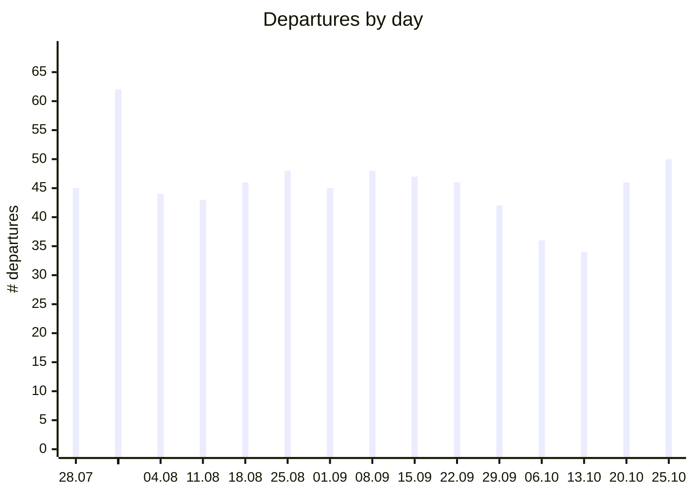

# tll-airport-departures

Tracking departures from Tallinn Airport. Data and graphs are updated daily.

I created this repo to:
- Test how to use Mermaid charting functions for basic reporting
- Test how to use Github Actions for scheudling basic data pipelines and transformations
- Find out where we can fly to from Tallinn

## Trend of Daily Departures

Last 90 days. One bar per day.



## Departures by quarter

Full history. Bars are the average departures per day. The line is the average number of destinations per day.


## Passengers in the terminal

Hour-by-hour forecast. Quiet, steady, busy, or crowded. Each flight is spread across the two hours before departure, and holiday flights count for more.

**2026-10-25**

| Hour | Terminal | Why |
| --- | --- | --- |
| 04:00 | busy | 13 flights, 4 charters (Antalya, Heraklion, Sharm El Sheikh +1) |
| 05:00 | busy | 11 flights, 4 charters (Antalya, Heraklion, Sharm El Sheikh +1) |
| 06:00 | steady | 7 flights, 2 charters (Sharm El Sheikh, Funchal) |
| 07:00 | quiet | 5 flights |
| 08:00 | quiet | 5 flights |
| 09:00 | quiet | 5 flights |
| 10:00 | quiet | 7 flights |
| 11:00 | steady | 8 flights, 1 charter (Sharm El Sheikh) |
| 12:00 | steady | 10 flights, 1 charter (Sharm El Sheikh) |
| 13:00 | steady | 9 flights, 1 charter (Sharm El Sheikh) |
| 14:00 | steady | 10 flights |
| 15:00 | steady | 12 flights |
| 16:00 | steady | 8 flights |
| 17:00 | quiet | 4 flights |
| 18:00 | quiet | 3 flights |
| 19:00 | quiet | 5 flights |
| 20:00 | quiet | 5 flights |
| 21:00 | quiet | 2 flights |
| 22:00 | quiet | no flights |

## Unique destinations and departures

Departures to each city since 1 Aug 2024. Airports in the same city are counted together. A multi-stop flight is counted once for each city on the title. The rates are averages over that whole span, and a longer bar means more departures.

```
Helsingi                         6803   8.3/day   58.4/wk   254.1/mo  3048.8/yr  ████████████████████████
Stockholm                        3231   4.0/day   27.8/wk   120.7/mo  1448.0/yr  ███████████
Riia                             3104   3.8/day   26.7/wk   115.9/mo  1391.1/yr  ███████████
Varssavi                         2522   3.1/day   21.7/wk    94.2/mo  1130.3/yr  █████████
Frankfurt                        1935   2.4/day   16.6/wk    72.3/mo   867.2/yr  ███████
Kopenhaagen                      1665   2.0/day   14.3/wk    62.2/mo   746.2/yr  ██████
Amsterdam                        1326   1.6/day   11.4/wk    49.5/mo   594.3/yr  █████
Kardla                           1290   1.6/day   11.1/wk    48.2/mo   578.1/yr  █████
London                           1282   1.6/day   11.0/wk    47.9/mo   574.5/yr  █████
Kuressaare                       1264   1.6/day   10.9/wk    47.2/mo   566.5/yr  ████
Vilnius                          1150   1.4/day    9.9/wk    42.9/mo   515.4/yr  ████
Istanbul                          934   1.1/day    8.0/wk    34.9/mo   418.6/yr  ███
Antalya                           781   1.0/day    6.7/wk    29.2/mo   350.0/yr  ███
Munchen                           656   0.8/day    5.6/wk    24.5/mo   294.0/yr  ██
Berliin                           654   0.8/day    5.6/wk    24.4/mo   293.1/yr  ██
Oslo                              605   0.7/day    5.2/wk    22.6/mo   271.1/yr  ██
Pariis                            574   0.7/day    4.9/wk    21.4/mo   257.2/yr  ██
Zurich                            495   0.6/day    4.3/wk    18.5/mo   221.8/yr  ██
Brussel                           454   0.6/day    3.9/wk    17.0/mo   203.5/yr  ██
Milano                            383   0.5/day    3.3/wk    14.3/mo   171.6/yr  █
Barcelona                         378   0.5/day    3.2/wk    14.1/mo   169.4/yr  █
Malaga                            276   0.3/day    2.4/wk    10.3/mo   123.7/yr  █
Sharm El Sheikh                   264   0.3/day    2.3/wk     9.9/mo   118.3/yr  █
Heraklion                         246   0.3/day    2.1/wk     9.2/mo   110.2/yr  █
Dublin                            219   0.3/day    1.9/wk     8.2/mo    98.1/yr  █
Krakow                            202   0.2/day    1.7/wk     7.5/mo    90.5/yr  █
Viin                              193   0.2/day    1.7/wk     7.2/mo    86.5/yr  █
Hurghada                          176   0.2/day    1.5/wk     6.6/mo    78.9/yr  █
Budapest                          175   0.2/day    1.5/wk     6.5/mo    78.4/yr  █
Rooma                             169   0.2/day    1.5/wk     6.3/mo    75.7/yr  █
Praha                             155   0.2/day    1.3/wk     5.8/mo    69.5/yr  █
Nice                              150   0.2/day    1.3/wk     5.6/mo    67.2/yr  █
Tenerife                          129   0.2/day    1.1/wk     4.8/mo    57.8/yr  █
Gdansk                            123   0.2/day    1.1/wk     4.6/mo    55.1/yr  █
Rhodos                            119   0.1/day    1.0/wk     4.4/mo    53.3/yr  █
Tirana                            119   0.1/day    1.0/wk     4.4/mo    53.3/yr  █
Tivat                             115   0.1/day    1.0/wk     4.3/mo    51.5/yr  █
Billund                           114   0.1/day    1.0/wk     4.3/mo    51.1/yr  █
Burgas                            104   0.1/day    0.9/wk     3.9/mo    46.6/yr  █
Split                              98   0.1/day    0.8/wk     3.7/mo    43.9/yr  █
Veneetsia                          93   0.1/day    0.8/wk     3.5/mo    41.7/yr  █
Malta                              76   0.1/day    0.7/wk     2.8/mo    34.1/yr  █
Veneetsia-Treviso                  67   0.1/day    0.6/wk     2.5/mo    30.0/yr  █
Paphos                             66   0.1/day    0.6/wk     2.5/mo    29.6/yr  █
Palma De Mallorca                  65   0.1/day    0.6/wk     2.4/mo    29.1/yr  █
Gran Canaria                       60   0.1/day    0.5/wk     2.2/mo    26.9/yr  █
Dusseldorf                         51   0.1/day    0.4/wk     1.9/mo    22.9/yr  █
Hamburg                            47   0.1/day    0.4/wk     1.8/mo    21.1/yr  █
Tampere                            38   0.0/day    0.3/wk     1.4/mo    17.0/yr  █
Enfidha                            35   0.0/day    0.3/wk     1.3/mo    15.7/yr  █
Funchal                            35   0.0/day    0.3/wk     1.3/mo    15.7/yr  █
Salzburg                           27   0.0/day    0.2/wk     1.0/mo    12.1/yr  █
Genf                               26   0.0/day    0.2/wk     1.0/mo    11.7/yr  █
Dubrovnik                          21   0.0/day    0.2/wk     0.8/mo     9.4/yr  █
Kittila                            21   0.0/day    0.2/wk     0.8/mo     9.4/yr  █
Reykjavik                          20   0.0/day    0.2/wk     0.7/mo     9.0/yr  █
Ateena                             16   0.0/day    0.1/wk     0.6/mo     7.2/yr  █
Bodrum                             16   0.0/day    0.1/wk     0.6/mo     7.2/yr  █
Larnaca                            15   0.0/day    0.1/wk     0.6/mo     6.7/yr  █
Lamezia                            14   0.0/day    0.1/wk     0.5/mo     6.3/yr  █
Manchester                         11   0.0/day    0.1/wk     0.4/mo     4.9/yr  █
Madriid                            10   0.0/day    0.1/wk     0.4/mo     4.5/yr  █
Birmingham                          8   0.0/day    0.1/wk     0.3/mo     3.6/yr  █
Edinburgh                           8   0.0/day    0.1/wk     0.3/mo     3.6/yr  █
Catania                             5   0.0/day    0.0/wk     0.2/mo     2.2/yr  █
Faro                                5   0.0/day    0.0/wk     0.2/mo     2.2/yr  █
Kerkira                             4   0.0/day    0.0/wk     0.1/mo     1.8/yr  █
Visby                               4   0.0/day    0.0/wk     0.1/mo     1.8/yr  █
Goteborg                            3   0.0/day    0.0/wk     0.1/mo     1.3/yr  █
Trieste                             2   0.0/day    0.0/wk     0.1/mo     0.9/yr  █
Tel Aviv                            2   0.0/day    0.0/wk     0.1/mo     0.9/yr  █
Tromso                              2   0.0/day    0.0/wk     0.1/mo     0.9/yr  █
Linz                                2   0.0/day    0.0/wk     0.1/mo     0.9/yr  █
Bratislava                          2   0.0/day    0.0/wk     0.1/mo     0.9/yr  █
Leon                                2   0.0/day    0.0/wk     0.1/mo     0.9/yr  █
Istres Le Tube Istres Air Base      2   0.0/day    0.0/wk     0.1/mo     0.9/yr  █
Cagliari                            2   0.0/day    0.0/wk     0.1/mo     0.9/yr  █
Craiova                             1   0.0/day    0.0/wk     0.0/mo     0.4/yr  █
La Rioja                            1   0.0/day    0.0/wk     0.0/mo     0.4/yr  █
Pamplona                            1   0.0/day    0.0/wk     0.0/mo     0.4/yr  █
Luxembourg                          1   0.0/day    0.0/wk     0.0/mo     0.4/yr  █
Bern                                1   0.0/day    0.0/wk     0.0/mo     0.4/yr  █
Katowice                            1   0.0/day    0.0/wk     0.0/mo     0.4/yr  █
Malmo                               1   0.0/day    0.0/wk     0.0/mo     0.4/yr  █
Tbilisi                             1   0.0/day    0.0/wk     0.0/mo     0.4/yr  █
Liverpool                           1   0.0/day    0.0/wk     0.0/mo     0.4/yr  █
Brno                                1   0.0/day    0.0/wk     0.0/mo     0.4/yr  █
Pardubice                           1   0.0/day    0.0/wk     0.0/mo     0.4/yr  █
Bucharest                           1   0.0/day    0.0/wk     0.0/mo     0.4/yr  █
Bahrain                             1   0.0/day    0.0/wk     0.0/mo     0.4/yr  █
Pisa                                1   0.0/day    0.0/wk     0.0/mo     0.4/yr  █
Hambantota                          1   0.0/day    0.0/wk     0.0/mo     0.4/yr  █
Fort Worth                          1   0.0/day    0.0/wk     0.0/mo     0.4/yr  █
Kalamata                            1   0.0/day    0.0/wk     0.0/mo     0.4/yr  █
RAF Brize Norton                    1   0.0/day    0.0/wk     0.0/mo     0.4/yr  █
Szczecin-Goleniow Solidarnosc       1   0.0/day    0.0/wk     0.0/mo     0.4/yr  █
Debrecen                            1   0.0/day    0.0/wk     0.0/mo     0.4/yr  █
Trondheim                           1   0.0/day    0.0/wk     0.0/mo     0.4/yr  █
RzeszowJasionka                     1   0.0/day    0.0/wk     0.0/mo     0.4/yr  █
Verona                              1   0.0/day    0.0/wk     0.0/mo     0.4/yr  █
Farnborough                         1   0.0/day    0.0/wk     0.0/mo     0.4/yr  █
Akureyri                            1   0.0/day    0.0/wk     0.0/mo     0.4/yr  █
Kosice                              1   0.0/day    0.0/wk     0.0/mo     0.4/yr  █
```
