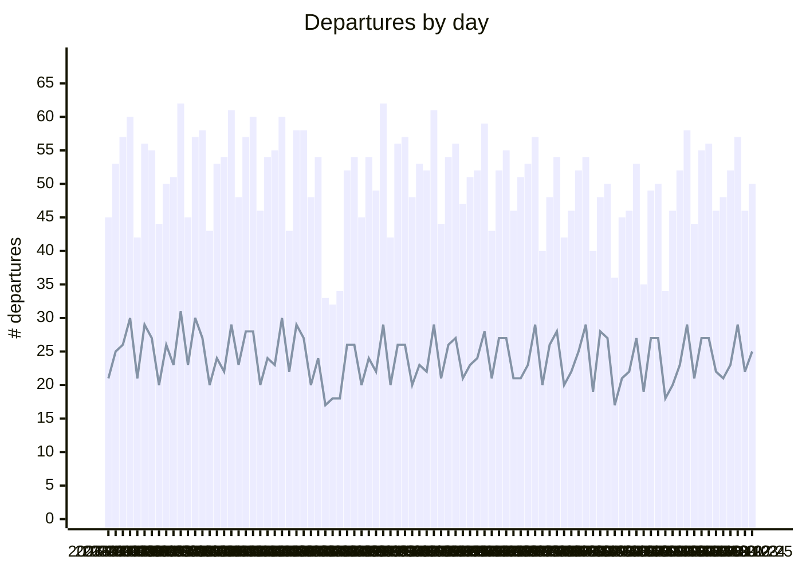

# tll-airport-departures

Tracking departures from Tallinn Airport. Data and graphs are updated daily.

I created this repo to:
- Test how to use Mermaid charting functions for basic reporting
- Test how to use Github Actions for scheudling basic data pipelines and transformations
- Find out where we can fly to from Tallinn

## Trend of Daily Departures

Bars for total number of departures. Line for unique destinations.




## Unique destinations and departures

All destinations flown to from Tallinn. More departures = bigger node.
Note that umlauts don't seem to be supported in Mermaid Sankey Diagrams (experimental diagram).

```mermaid
---
config:
  sankey:
    showValues: false
    width: 800
    height: 1000
---
sankey-beta
%% source,target,value
Tallinn,Akureyri,1
Tallinn,Amsterdam,1326
Tallinn,Antalya,781
Tallinn,Ateena,16
Tallinn,"Bahrain,Hambantota",1
Tallinn,Barcelona,377
Tallinn,Berliin,654
Tallinn,Bern,1
Tallinn,Billund,113
Tallinn,"Billund,Pariis (Charles De Gaulle)",1
Tallinn,Birmingham,8
Tallinn,Bodrum,16
Tallinn,Bratislava,2
Tallinn,Brno,1
Tallinn,Brussel,454
Tallinn,Bucharest,1
Tallinn,Budapest,175
Tallinn,Burgas,104
Tallinn,Cagliari,2
Tallinn,Catania,2
Tallinn,Craiova,1
Tallinn,Debrecen,1
Tallinn,Dublin,219
Tallinn,Dubrovnik,21
Tallinn,Dusseldorf,51
Tallinn,Edinburgh,8
Tallinn,Enfidha,35
Tallinn,Farnborough,1
Tallinn,Faro,4
Tallinn,"Faro,Faro",1
Tallinn,Fort Worth,1
Tallinn,Frankfurt,1935
Tallinn,Funchal,35
Tallinn,Gdańsk,123
Tallinn,Genf,26
Tallinn,Gran Canaria,60
Tallinn,Goteborg,3
Tallinn,Hamburg,47
Tallinn,Helsingi,6803
Tallinn,Heraklion,246
Tallinn,Hurghada,176
Tallinn,Istanbul,934
Tallinn,Istres Le TubeIstres Air Base,2
Tallinn,Kalamata,1
Tallinn,Katowice,1
Tallinn,Kerkira,4
Tallinn,Kopenhaagen,1665
Tallinn,Kosice,1
Tallinn,Kraków,202
Tallinn,Kuressaare,1261
Tallinn,Kardla,1287
Tallinn,"Kardla,Kuressaare",3
Tallinn,La Rioja,1
Tallinn,Lamezia,11
Tallinn,"Lamezia,Catania",3
Tallinn,Larnaca,15
Tallinn,León,2
Tallinn,Linz,2
Tallinn,Liverpool,1
Tallinn,London (Gatwick),331
Tallinn,London (Luton),409
Tallinn,London (Stansted),542
Tallinn,Luxembourg,1
Tallinn,Madriid,10
Tallinn,Malaga,276
Tallinn,Malmo,1
Tallinn,Malta,76
Tallinn,Manchester,11
Tallinn,Milano (Bergamo),132
Tallinn,Milano (Malpensa),251
Tallinn,Munchen,656
Tallinn,Nice,150
Tallinn,Oslo,605
Tallinn,Palma De Mallorca,65
Tallinn,Pamplona,1
Tallinn,Paphos,66
Tallinn,Pardubice,1
Tallinn,Pariis (Charles De Gaulle),499
Tallinn,Pariis (Orly),72
Tallinn,Pisa,1
Tallinn,Praha,155
Tallinn,RAF Brize Norton,1
Tallinn,Reykjavik,20
Tallinn,Rhodos,119
Tallinn,Riia,3103
Tallinn,"Riia,Barcelona",1
Tallinn,Rooma (Ciampino),80
Tallinn,Rooma (Fiumicino),88
Tallinn,Rzeszów–Jasionka,1
Tallinn,Salzburg,27
Tallinn,Sharm El Sheikh,264
Tallinn,Split,98
Tallinn,Stockholm (Arlanda),3228
Tallinn,"Stockholm (Arlanda),Pariis (Charles De Gaulle)",2
Tallinn,Stockholm (Bromma),1
Tallinn,"Szczecin-Goleniów ""Solidarność",1
Tallinn,Tallinn,4
Tallinn,Tampere,17
Tallinn,"Tampere,Kittila",21
Tallinn,Tbilisi,1
Tallinn,Tel Aviv,2
Tallinn,Tenerife (South),129
Tallinn,Tirana,119
Tallinn,Tivat,115
Tallinn,Trieste,1
Tallinn,"Trieste,Rooma (Fiumicino)",1
Tallinn,Tromsø,2
Tallinn,Trondheim,1
Tallinn,Varssavi,2522
Tallinn,Veneetsia,93
Tallinn,Veneetsia-Treviso,67
Tallinn,Verona,1
Tallinn,Viin,193
Tallinn,Vilnius,1150
Tallinn,Visby,4
Tallinn,Zurich,495


```
