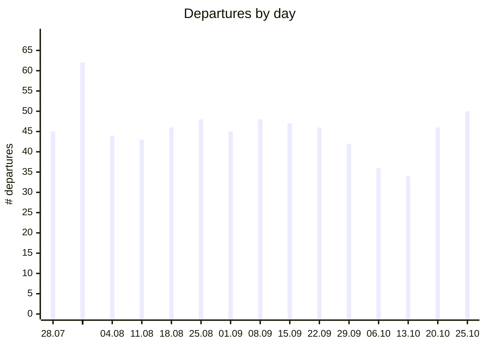

# tll-airport-departures

Tracking departures from Tallinn Airport. Data and graphs are updated daily.

I created this repo to:
- Test how to use Mermaid charting functions for basic reporting
- Test how to use Github Actions for scheudling basic data pipelines and transformations
- Find out where we can fly to from Tallinn

## Trend of Daily Departures

Last 90 days. One bar per day.



## Departures by quarter

Full history. Bars are the average departures per day. The line is the average number of destinations per day.


## Passengers in the terminal

Hour-by-hour forecast. Quiet, steady, busy, or crowded. Each flight is spread across the two hours before departure, and holiday flights count for more.

**2026-10-25**

| Hour | Terminal | Why |
| --- | --- | --- |
| 04:00 | busy | 13 flights, 4 charters (Antalya, Heraklion, Sharm El Sheikh +1) |
| 05:00 | busy | 11 flights, 4 charters (Antalya, Heraklion, Sharm El Sheikh +1) |
| 06:00 | steady | 7 flights, 2 charters (Sharm El Sheikh, Funchal) |
| 07:00 | quiet | 5 flights |
| 08:00 | quiet | 5 flights |
| 09:00 | quiet | 5 flights |
| 10:00 | quiet | 7 flights |
| 11:00 | steady | 8 flights, 1 charter (Sharm El Sheikh) |
| 12:00 | steady | 10 flights, 1 charter (Sharm El Sheikh) |
| 13:00 | steady | 9 flights, 1 charter (Sharm El Sheikh) |
| 14:00 | steady | 10 flights |
| 15:00 | steady | 12 flights |
| 16:00 | steady | 8 flights |
| 17:00 | quiet | 4 flights |
| 18:00 | quiet | 3 flights |
| 19:00 | quiet | 5 flights |
| 20:00 | quiet | 5 flights |
| 21:00 | quiet | 2 flights |
| 22:00 | quiet | no flights |

## Unique destinations and departures

Airports in the same city are counted together. A longer bar means more departures.

```
Helsingi                         6803  ████████████████████████████████
Stockholm                        3229  ███████████████
Riia                             3103  ███████████████
Varssavi                         2522  ████████████
Frankfurt                        1935  █████████
Kopenhaagen                      1665  ████████
Amsterdam                        1326  ██████
Kardla                           1287  ██████
London                           1282  ██████
Kuressaare                       1261  ██████
Vilnius                          1150  █████
Istanbul                          934  ████
Antalya                           781  ████
Munchen                           656  ███
Berliin                           654  ███
Oslo                              605  ███
Pariis                            571  ███
Zurich                            495  ██
Brussel                           454  ██
Milano                            383  ██
Barcelona                         377  ██
Malaga                            276  █
Sharm El Sheikh                   264  █
Heraklion                         246  █
Dublin                            219  █
Krakow                            202  █
Viin                              193  █
Hurghada                          176  █
Budapest                          175  █
Rooma                             168  █
Praha                             155  █
Nice                              150  █
Tenerife                          129  █
Gdansk                            123  █
Rhodos                            119  █
Tirana                            119  █
Tivat                             115  █
Billund                           113  █
Burgas                            104  █
Split                              98  █
Veneetsia                          93  █
Malta                              76  █
Veneetsia-Treviso                  67  █
Paphos                             66  █
Palma De Mallorca                  65  █
Gran Canaria                       60  █
Dusseldorf                         51  █
Hamburg                            47  █
Funchal                            35  █
Enfidha                            35  █
Salzburg                           27  █
Genf                               26  █
Dubrovnik                          21  █
Tampere Kittila                    21  █
Reykjavik                          20  █
Tampere                            17  █
Ateena                             16  █
Bodrum                             16  █
Larnaca                            15  █
Manchester                         11  █
Lamezia                            11  █
Madriid                            10  █
Birmingham                          8  █
Edinburgh                           8  █
Kerkira                             4  █
Visby                               4  █
Faro                                4  █
Goteborg                            3  █
Lamezia Catania                     3  █
Kardla Kuressaare                   3  █
Istres Le Tube Istres Air Base      2  █
Catania                             2  █
Tel Aviv                            2  █
Leon                                2  █
Tromso                              2  █
Cagliari                            2  █
Stockholm Pariis                    2  █
Linz                                2  █
Bratislava                          2  █
Billund Pariis                      1  █
Liverpool                           1  █
La Rioja                            1  █
RAF Brize Norton                    1  █
Verona                              1  █
Fort Worth                          1  █
Brno                                1  █
Pamplona                            1  █
Craiova                             1  █
Trieste                             1  █
Trieste Rooma                       1  █
Kalamata                            1  █
Malmo                               1  █
Bahrain Hambantota                  1  █
Kosice                              1  █
Farnborough                         1  █
Riia Barcelona                      1  █
Pardubice                           1  █
Trondheim                           1  █
Luxembourg                          1  █
Tbilisi                             1  █
Bucharest                           1  █
Katowice                            1  █
Szczecin-Goleniow Solidarnosc       1  █
Pisa                                1  █
Akureyri                            1  █
Faro Faro                           1  █
RzeszowJasionka                     1  █
Debrecen                            1  █
Bern                                1  █
```
