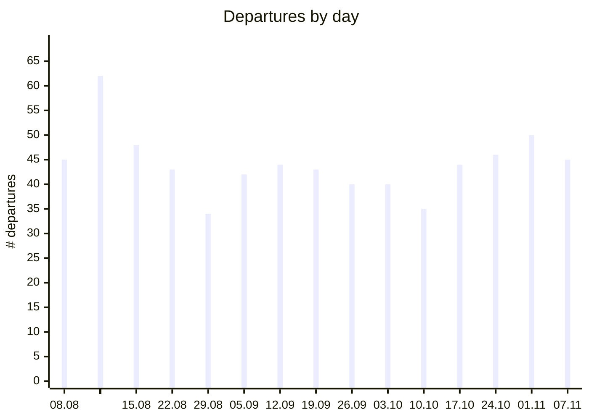
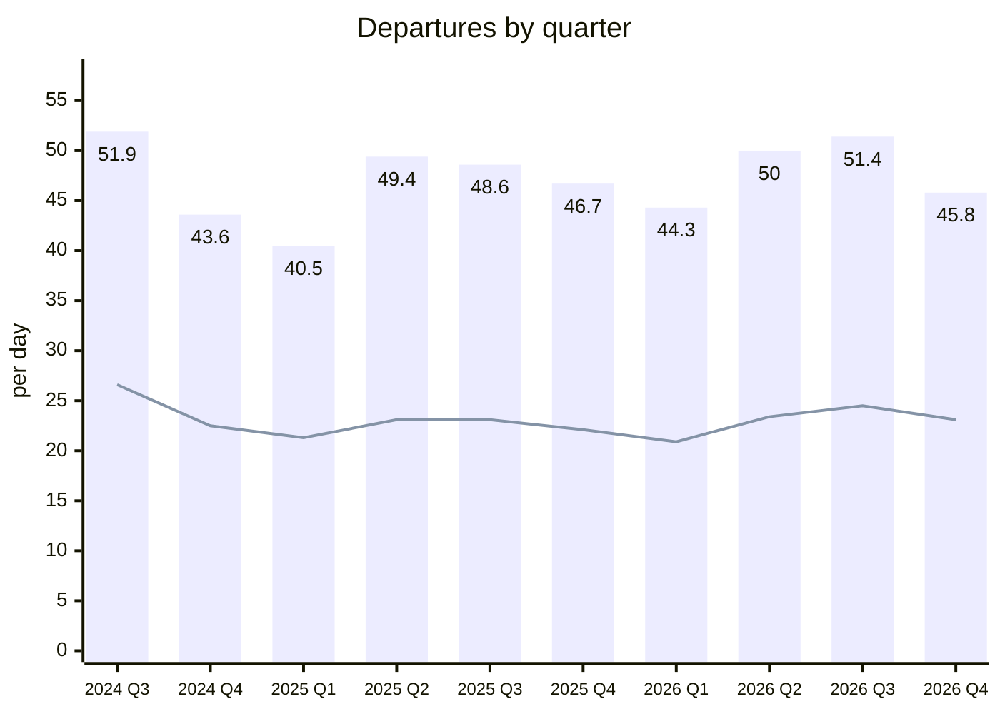

# tll-airport-departures

Tracking departures from Tallinn Airport. Data and graphs are updated daily.

## Flights in the terminal

| Hour | 7 Nov | Flights | | 8 Nov | Flights |
| --- | --- | ---: | --- | --- | ---: |
| 04:00 | 7 Nov | 7 | | 8 Nov | 6 |
| 05:00 | 7 Nov | 12 | | 8 Nov | 9 |
| 06:00 | 7 Nov | 12 | | 8 Nov | 8 |
| 07:00 | 7 Nov | 13 | | 8 Nov | 8 |
| 08:00 | 7 Nov | 9 | | 8 Nov | 11 |
| 09:00 | 7 Nov | 9 | | 8 Nov | 12 |
| 10:00 | 7 Nov | 7 | | 8 Nov | 11 |
| 11:00 | 7 Nov | 8 | | 8 Nov | 9 |
| 12:00 | 7 Nov | 9 | | 8 Nov | 10 |
| 13:00 | 7 Nov | 12 | | 8 Nov | 12 |
| 14:00 | 7 Nov | 10 | | 8 Nov | 9 |
| 15:00 | 7 Nov | 9 | | 8 Nov | 10 |
| 16:00 | 7 Nov | 9 | | 8 Nov | 11 |
| 17:00 | 7 Nov | 6 | | 8 Nov | 8 |
| 18:00 | 7 Nov | 4 | | 8 Nov | 4 |
| 19:00 | 7 Nov | 4 | | 8 Nov | 3 |
| 20:00 | 7 Nov | 5 | | 8 Nov | 5 |
| 21:00 | 7 Nov | 5 | | 8 Nov | 5 |
| 22:00 | 7 Nov | 2 | | 8 Nov | 2 |

Each flight is counted in the two hours before it leaves.

## When the terminal is busiest

Averages from 1 Aug 2024 through 7 Nov 2026, 764 days. Weekday and month numbers are the average of that day’s busiest hour.

05:00 is the busiest hour (10.2 flights). 22:00 is the quietest (1.9).
Friday is the busiest weekday (13.2). Saturday is the quietest (10.2).
September is the busiest month (12.7). January is the quietest (10.8).

| Hour | Avg flights | | Weekday | Avg peak | | Month | Avg peak |
| --- | ---: | --- | --- | ---: | --- | --- | ---: |
| 04:00 | 5.6 | | Monday | 12.4 | | January | 10.8 |
| 05:00 | 10.2 | | Tuesday | 12.0 | | February | 11.1 |
| 06:00 | 9.2 | | Wednesday | 11.5 | | March | 11.5 |
| 07:00 | 7.7 | | Thursday | 11.8 | | April | 11.6 |
| 08:00 | 5.2 | | Friday | 13.2 | | May | 11.9 |
| 09:00 | 5.6 | | Saturday | 10.2 | | June | 12.1 |
| 10:00 | 5.9 | | Sunday | 11.5 | | July | 12.1 |
| 11:00 | 5.3 | |  |  | | August | 12.5 |
| 12:00 | 7.4 | |  |  | | September | 12.7 |
| 13:00 | 8.2 | |  |  | | October | 12.1 |
| 14:00 | 8.9 | |  |  | | November | 11.2 |
| 15:00 | 8.8 | |  |  | | December | 11.1 |
| 16:00 | 9.3 | |  |  | |  |  |
| 17:00 | 7.0 | |  |  | |  |  |
| 18:00 | 6.1 | |  |  | |  |  |
| 19:00 | 5.1 | |  |  | |  |  |
| 20:00 | 5.0 | |  |  | |  |  |
| 21:00 | 4.3 | |  |  | |  |  |
| 22:00 | 1.9 | |  |  | |  |  |

## Trend of Daily Departures

Last 90 days. One bar per day.



## Departures by quarter

Full history. Bars are the average departures per day. The line is the average number of destinations per day.



## Unique destinations and departures

Departures to each city since 1 Aug 2024. Airports in the same city are counted together. A multi-stop flight is counted once for each city on the title. The rates are averages over that whole span, and a longer bar means more departures.

```
Helsingi                         6889   8.3/day   58.2/wk   253.2/mo  3038.9/yr  ████████████████████████
Stockholm                        3266   3.9/day   27.6/wk   120.1/mo  1440.7/yr  ███████████
Riia                             3134   3.8/day   26.5/wk   115.2/mo  1382.5/yr  ███████████
Varssavi                         2558   3.1/day   21.6/wk    94.0/mo  1128.4/yr  █████████
Frankfurt                        1957   2.4/day   16.5/wk    71.9/mo   863.3/yr  ███████
Kopenhaagen                      1686   2.0/day   14.3/wk    62.0/mo   743.7/yr  ██████
Amsterdam                        1340   1.6/day   11.3/wk    49.3/mo   591.1/yr  █████
Kardla                           1307   1.6/day   11.0/wk    48.0/mo   576.5/yr  █████
London                           1295   1.6/day   10.9/wk    47.6/mo   571.3/yr  █████
Kuressaare                       1281   1.5/day   10.8/wk    47.1/mo   565.1/yr  ████
Vilnius                          1167   1.4/day    9.9/wk    42.9/mo   514.8/yr  ████
Istanbul                          948   1.1/day    8.0/wk    34.8/mo   418.2/yr  ███
Antalya                           804   1.0/day    6.8/wk    29.6/mo   354.7/yr  ███
Munchen                           660   0.8/day    5.6/wk    24.3/mo   291.1/yr  ██
Berliin                           658   0.8/day    5.6/wk    24.2/mo   290.3/yr  ██
Oslo                              611   0.7/day    5.2/wk    22.5/mo   269.5/yr  ██
Pariis                            581   0.7/day    4.9/wk    21.4/mo   256.3/yr  ██
Zurich                            496   0.6/day    4.2/wk    18.2/mo   218.8/yr  ██
Brussel                           460   0.6/day    3.9/wk    16.9/mo   202.9/yr  ██
Milano                            388   0.5/day    3.3/wk    14.3/mo   171.2/yr  █
Barcelona                         383   0.5/day    3.2/wk    14.1/mo   169.0/yr  █
Malaga                            280   0.3/day    2.4/wk    10.3/mo   123.5/yr  █
Sharm El Sheikh                   271   0.3/day    2.3/wk    10.0/mo   119.5/yr  █
Heraklion                         246   0.3/day    2.1/wk     9.0/mo   108.5/yr  █
Dublin                            224   0.3/day    1.9/wk     8.2/mo    98.8/yr  █
Krakow                            212   0.3/day    1.8/wk     7.8/mo    93.5/yr  █
Viin                              195   0.2/day    1.6/wk     7.2/mo    86.0/yr  █
Budapest                          183   0.2/day    1.5/wk     6.7/mo    80.7/yr  █
Hurghada                          180   0.2/day    1.5/wk     6.6/mo    79.4/yr  █
Rooma                             172   0.2/day    1.5/wk     6.3/mo    75.9/yr  █
Praha                             155   0.2/day    1.3/wk     5.7/mo    68.4/yr  █
Nice                              154   0.2/day    1.3/wk     5.7/mo    67.9/yr  █
Tenerife                          133   0.2/day    1.1/wk     4.9/mo    58.7/yr  █
Gdansk                            127   0.2/day    1.1/wk     4.7/mo    56.0/yr  █
Tirana                            119   0.1/day    1.0/wk     4.4/mo    52.5/yr  █
Rhodos                            119   0.1/day    1.0/wk     4.4/mo    52.5/yr  █
Tivat                             115   0.1/day    1.0/wk     4.2/mo    50.7/yr  █
Billund                           114   0.1/day    1.0/wk     4.2/mo    50.3/yr  █
Burgas                            104   0.1/day    0.9/wk     3.8/mo    45.9/yr  █
Split                              98   0.1/day    0.8/wk     3.6/mo    43.2/yr  █
Veneetsia                          95   0.1/day    0.8/wk     3.5/mo    41.9/yr  █
Malta                              78   0.1/day    0.7/wk     2.9/mo    34.4/yr  █
Veneetsia-Treviso                  67   0.1/day    0.6/wk     2.5/mo    29.6/yr  █
Paphos                             66   0.1/day    0.6/wk     2.4/mo    29.1/yr  █
Palma De Mallorca                  65   0.1/day    0.5/wk     2.4/mo    28.7/yr  █
Gran Canaria                       60   0.1/day    0.5/wk     2.2/mo    26.5/yr  █
Dusseldorf                         55   0.1/day    0.5/wk     2.0/mo    24.3/yr  █
Hamburg                            47   0.1/day    0.4/wk     1.7/mo    20.7/yr  █
Tampere                            38   0.0/day    0.3/wk     1.4/mo    16.8/yr  █
Funchal                            36   0.0/day    0.3/wk     1.3/mo    15.9/yr  █
Enfidha                            35   0.0/day    0.3/wk     1.3/mo    15.4/yr  █
Salzburg                           27   0.0/day    0.2/wk     1.0/mo    11.9/yr  █
Genf                               26   0.0/day    0.2/wk     1.0/mo    11.5/yr  █
Dubrovnik                          21   0.0/day    0.2/wk     0.8/mo     9.3/yr  █
Kittila                            21   0.0/day    0.2/wk     0.8/mo     9.3/yr  █
Reykjavik                          20   0.0/day    0.2/wk     0.7/mo     8.8/yr  █
Bodrum                             16   0.0/day    0.1/wk     0.6/mo     7.1/yr  █
Larnaca                            16   0.0/day    0.1/wk     0.6/mo     7.1/yr  █
Ateena                             16   0.0/day    0.1/wk     0.6/mo     7.1/yr  █
Lamezia                            14   0.0/day    0.1/wk     0.5/mo     6.2/yr  █
Manchester                         11   0.0/day    0.1/wk     0.4/mo     4.9/yr  █
Madriid                            10   0.0/day    0.1/wk     0.4/mo     4.4/yr  █
Edinburgh                           8   0.0/day    0.1/wk     0.3/mo     3.5/yr  █
Birmingham                          8   0.0/day    0.1/wk     0.3/mo     3.5/yr  █
Catania                             5   0.0/day    0.0/wk     0.2/mo     2.2/yr  █
Faro                                5   0.0/day    0.0/wk     0.2/mo     2.2/yr  █
Kerkira                             4   0.0/day    0.0/wk     0.1/mo     1.8/yr  █
Visby                               4   0.0/day    0.0/wk     0.1/mo     1.8/yr  █
Goteborg                            3   0.0/day    0.0/wk     0.1/mo     1.3/yr  █
Cagliari                            2   0.0/day    0.0/wk     0.1/mo     0.9/yr  █
Leon                                2   0.0/day    0.0/wk     0.1/mo     0.9/yr  █
Tel Aviv                            2   0.0/day    0.0/wk     0.1/mo     0.9/yr  █
Bratislava                          2   0.0/day    0.0/wk     0.1/mo     0.9/yr  █
Istres Le Tube Istres Air Base      2   0.0/day    0.0/wk     0.1/mo     0.9/yr  █
Linz                                2   0.0/day    0.0/wk     0.1/mo     0.9/yr  █
Trieste                             2   0.0/day    0.0/wk     0.1/mo     0.9/yr  █
Tromso                              2   0.0/day    0.0/wk     0.1/mo     0.9/yr  █
Debrecen                            1   0.0/day    0.0/wk     0.0/mo     0.4/yr  █
Pisa                                1   0.0/day    0.0/wk     0.0/mo     0.4/yr  █
Hambantota                          1   0.0/day    0.0/wk     0.0/mo     0.4/yr  █
Bahrain                             1   0.0/day    0.0/wk     0.0/mo     0.4/yr  █
Pamplona                            1   0.0/day    0.0/wk     0.0/mo     0.4/yr  █
Szczecin-Goleniow Solidarnosc       1   0.0/day    0.0/wk     0.0/mo     0.4/yr  █
Luxembourg                          1   0.0/day    0.0/wk     0.0/mo     0.4/yr  █
Kosice                              1   0.0/day    0.0/wk     0.0/mo     0.4/yr  █
Liverpool                           1   0.0/day    0.0/wk     0.0/mo     0.4/yr  █
Bucharest                           1   0.0/day    0.0/wk     0.0/mo     0.4/yr  █
Farnborough                         1   0.0/day    0.0/wk     0.0/mo     0.4/yr  █
Malmo                               1   0.0/day    0.0/wk     0.0/mo     0.4/yr  █
RzeszowJasionka                     1   0.0/day    0.0/wk     0.0/mo     0.4/yr  █
Craiova                             1   0.0/day    0.0/wk     0.0/mo     0.4/yr  █
RAF Brize Norton                    1   0.0/day    0.0/wk     0.0/mo     0.4/yr  █
Kalamata                            1   0.0/day    0.0/wk     0.0/mo     0.4/yr  █
Bern                                1   0.0/day    0.0/wk     0.0/mo     0.4/yr  █
Akureyri                            1   0.0/day    0.0/wk     0.0/mo     0.4/yr  █
Katowice                            1   0.0/day    0.0/wk     0.0/mo     0.4/yr  █
Fort Worth                          1   0.0/day    0.0/wk     0.0/mo     0.4/yr  █
Brno                                1   0.0/day    0.0/wk     0.0/mo     0.4/yr  █
Tbilisi                             1   0.0/day    0.0/wk     0.0/mo     0.4/yr  █
Verona                              1   0.0/day    0.0/wk     0.0/mo     0.4/yr  █
Pardubice                           1   0.0/day    0.0/wk     0.0/mo     0.4/yr  █
La Rioja                            1   0.0/day    0.0/wk     0.0/mo     0.4/yr  █
Trondheim                           1   0.0/day    0.0/wk     0.0/mo     0.4/yr  █
```
