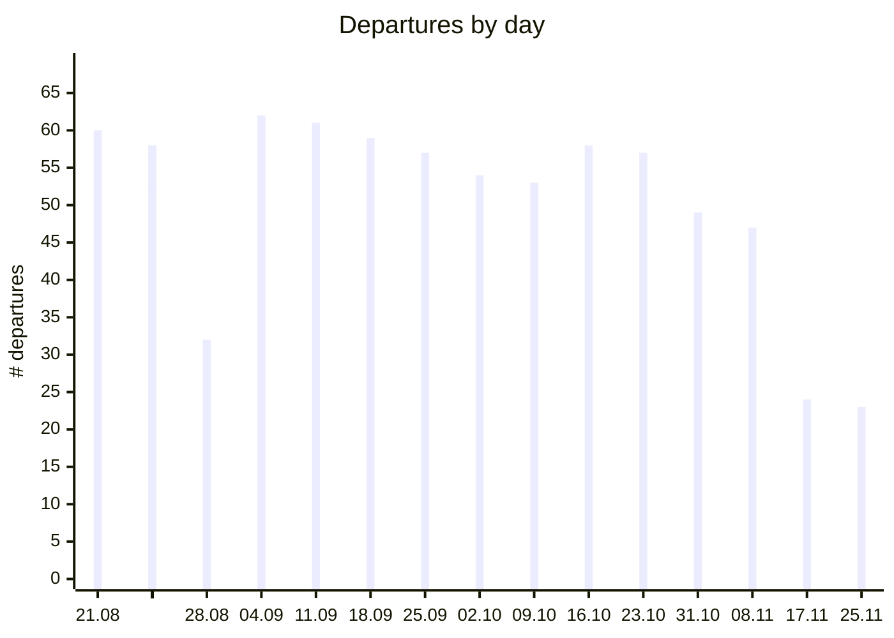
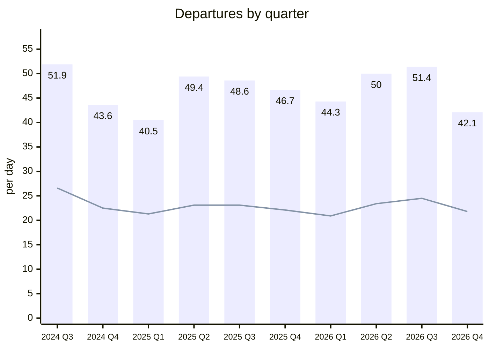

# tll-airport-departures

Tracking departures from Tallinn Airport. Data and graphs are updated daily.

## Flights in the terminal

| Hour | 25 Nov | Flights | | 26 Nov | Flights |
| --- | --- | ---: | --- | --- | ---: |
| 04:00 | 25 Nov | 5 | | 26 Nov | 6 |
| 05:00 | 25 Nov | 12 | | 26 Nov | 10 |
| 06:00 | 25 Nov | 11 | | 26 Nov | 9 |
| 07:00 | 25 Nov | 9 | | 26 Nov | 9 |
| 08:00 | 25 Nov | 4 | | 26 Nov | 6 |
| 09:00 | 25 Nov | 5 | | 26 Nov | 6 |
| 10:00 | 25 Nov | 5 | | 26 Nov | 4 |
| 11:00 | 25 Nov | 5 | | 26 Nov | 4 |
| 12:00 | 25 Nov | 6 | | 26 Nov | 8 |
| 13:00 | 25 Nov | 8 | | 26 Nov | 10 |
| 14:00 | 25 Nov | 8 | | 26 Nov | 10 |
| 15:00 | 25 Nov | 7 | | 26 Nov | 8 |
| 16:00 | 25 Nov | 9 | | 26 Nov | 10 |
| 17:00 | 25 Nov | 6 | | 26 Nov | 7 |
| 18:00 | 25 Nov | 4 | | 26 Nov | 5 |
| 19:00 | 25 Nov | 5 | | 26 Nov | 3 |
| 20:00 | 25 Nov | 6 | | 26 Nov | 5 |
| 21:00 | 25 Nov | 5 | | 26 Nov | 4 |
| 22:00 | 25 Nov | 1 | | 26 Nov | 2 |

Each flight is counted in the two hours before it leaves.

## When the terminal is busiest

Averages from 1 Aug 2024 through 25 Nov 2026, 777 days. Weekday and month numbers are the average of that day’s busiest hour.

05:00 is the busiest hour (10.1 flights). 22:00 is the quietest (1.9).
Friday is the busiest weekday (13.2). Saturday is the quietest (10.2).
September is the busiest month (12.7). January is the quietest (10.8).

| Hour | Avg flights | | Weekday | Avg peak | | Month | Avg peak |
| --- | ---: | --- | --- | ---: | --- | --- | ---: |
| 04:00 | 5.6 | | Monday | 12.4 | | January | 10.8 |
| 05:00 | 10.1 | | Tuesday | 12.0 | | February | 11.1 |
| 06:00 | 9.1 | | Wednesday | 11.4 | | March | 11.5 |
| 07:00 | 7.6 | | Thursday | 11.8 | | April | 11.6 |
| 08:00 | 5.2 | | Friday | 13.2 | | May | 11.9 |
| 09:00 | 5.6 | | Saturday | 10.2 | | June | 12.1 |
| 10:00 | 5.9 | | Sunday | 11.4 | | July | 12.1 |
| 11:00 | 5.3 | |  |  | | August | 12.5 |
| 12:00 | 7.4 | |  |  | | September | 12.7 |
| 13:00 | 8.2 | |  |  | | October | 12.1 |
| 14:00 | 8.9 | |  |  | | November | 11.0 |
| 15:00 | 8.7 | |  |  | | December | 11.1 |
| 16:00 | 9.3 | |  |  | |  |  |
| 17:00 | 6.9 | |  |  | |  |  |
| 18:00 | 6.1 | |  |  | |  |  |
| 19:00 | 5.1 | |  |  | |  |  |
| 20:00 | 5.0 | |  |  | |  |  |
| 21:00 | 4.3 | |  |  | |  |  |
| 22:00 | 1.9 | |  |  | |  |  |

## Trend of Daily Departures

Last 90 days. One bar per day.



## Departures by quarter

Full history. Bars are the average departures per day. The line is the average number of destinations per day.



## Unique destinations and departures

Departures to each city since 1 Aug 2024. Airports in the same city are counted together. A multi-stop flight is counted once for each city on the title. The rates are averages over that whole span, and a longer bar means more departures.

```
Helsingi                         6982   8.3/day   57.8/wk   251.2/mo  3014.4/yr  ████████████████████████
Stockholm                        3297   3.9/day   27.3/wk   118.6/mo  1423.4/yr  ███████████
Riia                             3162   3.7/day   26.2/wk   113.8/mo  1365.2/yr  ███████████
Varssavi                         2593   3.1/day   21.5/wk    93.3/mo  1119.5/yr  █████████
Frankfurt                        1978   2.3/day   16.4/wk    71.2/mo   854.0/yr  ███████
Kopenhaagen                      1709   2.0/day   14.1/wk    61.5/mo   737.8/yr  ██████
Amsterdam                        1353   1.6/day   11.2/wk    48.7/mo   584.1/yr  █████
Kardla                           1320   1.6/day   10.9/wk    47.5/mo   569.9/yr  █████
London                           1309   1.5/day   10.8/wk    47.1/mo   565.1/yr  ████
Kuressaare                       1293   1.5/day   10.7/wk    46.5/mo   558.2/yr  ████
Vilnius                          1180   1.4/day    9.8/wk    42.5/mo   509.5/yr  ████
Istanbul                          963   1.1/day    8.0/wk    34.6/mo   415.8/yr  ███
Antalya                           816   1.0/day    6.8/wk    29.4/mo   352.3/yr  ███
Munchen                           664   0.8/day    5.5/wk    23.9/mo   286.7/yr  ██
Berliin                           658   0.8/day    5.4/wk    23.7/mo   284.1/yr  ██
Oslo                              615   0.7/day    5.1/wk    22.1/mo   265.5/yr  ██
Pariis                            586   0.7/day    4.8/wk    21.1/mo   253.0/yr  ██
Zurich                            498   0.6/day    4.1/wk    17.9/mo   215.0/yr  ██
Brussel                           465   0.5/day    3.8/wk    16.7/mo   200.8/yr  ██
Milano                            392   0.5/day    3.2/wk    14.1/mo   169.2/yr  █
Barcelona                         388   0.5/day    3.2/wk    14.0/mo   167.5/yr  █
Malaga                            286   0.3/day    2.4/wk    10.3/mo   123.5/yr  █
Sharm El Sheikh                   279   0.3/day    2.3/wk    10.0/mo   120.5/yr  █
Heraklion                         246   0.3/day    2.0/wk     8.9/mo   106.2/yr  █
Dublin                            228   0.3/day    1.9/wk     8.2/mo    98.4/yr  █
Krakow                            224   0.3/day    1.9/wk     8.1/mo    96.7/yr  █
Viin                              197   0.2/day    1.6/wk     7.1/mo    85.1/yr  █
Budapest                          189   0.2/day    1.6/wk     6.8/mo    81.6/yr  █
Hurghada                          187   0.2/day    1.5/wk     6.7/mo    80.7/yr  █
Rooma                             175   0.2/day    1.4/wk     6.3/mo    75.6/yr  █
Praha                             155   0.2/day    1.3/wk     5.6/mo    66.9/yr  █
Nice                              154   0.2/day    1.3/wk     5.5/mo    66.5/yr  █
Tenerife                          135   0.2/day    1.1/wk     4.9/mo    58.3/yr  █
Gdansk                            132   0.2/day    1.1/wk     4.7/mo    57.0/yr  █
Tirana                            119   0.1/day    1.0/wk     4.3/mo    51.4/yr  █
Rhodos                            119   0.1/day    1.0/wk     4.3/mo    51.4/yr  █
Tivat                             115   0.1/day    1.0/wk     4.1/mo    49.6/yr  █
Billund                           114   0.1/day    0.9/wk     4.1/mo    49.2/yr  █
Burgas                            104   0.1/day    0.9/wk     3.7/mo    44.9/yr  █
Split                              98   0.1/day    0.8/wk     3.5/mo    42.3/yr  █
Veneetsia                          96   0.1/day    0.8/wk     3.5/mo    41.4/yr  █
Malta                              78   0.1/day    0.6/wk     2.8/mo    33.7/yr  █
Veneetsia-Treviso                  67   0.1/day    0.6/wk     2.4/mo    28.9/yr  █
Paphos                             66   0.1/day    0.5/wk     2.4/mo    28.5/yr  █
Palma De Mallorca                  65   0.1/day    0.5/wk     2.3/mo    28.1/yr  █
Gran Canaria                       60   0.1/day    0.5/wk     2.2/mo    25.9/yr  █
Dusseldorf                         56   0.1/day    0.5/wk     2.0/mo    24.2/yr  █
Hamburg                            47   0.1/day    0.4/wk     1.7/mo    20.3/yr  █
Tampere                            38   0.0/day    0.3/wk     1.4/mo    16.4/yr  █
Funchal                            37   0.0/day    0.3/wk     1.3/mo    16.0/yr  █
Enfidha                            35   0.0/day    0.3/wk     1.3/mo    15.1/yr  █
Salzburg                           27   0.0/day    0.2/wk     1.0/mo    11.7/yr  █
Genf                               26   0.0/day    0.2/wk     0.9/mo    11.2/yr  █
Kittila                            21   0.0/day    0.2/wk     0.8/mo     9.1/yr  █
Dubrovnik                          21   0.0/day    0.2/wk     0.8/mo     9.1/yr  █
Reykjavik                          20   0.0/day    0.2/wk     0.7/mo     8.6/yr  █
Larnaca                            16   0.0/day    0.1/wk     0.6/mo     6.9/yr  █
Bodrum                             16   0.0/day    0.1/wk     0.6/mo     6.9/yr  █
Ateena                             16   0.0/day    0.1/wk     0.6/mo     6.9/yr  █
Lamezia                            14   0.0/day    0.1/wk     0.5/mo     6.0/yr  █
Manchester                         11   0.0/day    0.1/wk     0.4/mo     4.7/yr  █
Madriid                            10   0.0/day    0.1/wk     0.4/mo     4.3/yr  █
Birmingham                          9   0.0/day    0.1/wk     0.3/mo     3.9/yr  █
Edinburgh                           9   0.0/day    0.1/wk     0.3/mo     3.9/yr  █
Faro                                5   0.0/day    0.0/wk     0.2/mo     2.2/yr  █
Catania                             5   0.0/day    0.0/wk     0.2/mo     2.2/yr  █
Visby                               4   0.0/day    0.0/wk     0.1/mo     1.7/yr  █
Kerkira                             4   0.0/day    0.0/wk     0.1/mo     1.7/yr  █
Goteborg                            3   0.0/day    0.0/wk     0.1/mo     1.3/yr  █
Cagliari                            2   0.0/day    0.0/wk     0.1/mo     0.9/yr  █
Linz                                2   0.0/day    0.0/wk     0.1/mo     0.9/yr  █
Istres Le Tube Istres Air Base      2   0.0/day    0.0/wk     0.1/mo     0.9/yr  █
Tel Aviv                            2   0.0/day    0.0/wk     0.1/mo     0.9/yr  █
Leon                                2   0.0/day    0.0/wk     0.1/mo     0.9/yr  █
Bratislava                          2   0.0/day    0.0/wk     0.1/mo     0.9/yr  █
Trieste                             2   0.0/day    0.0/wk     0.1/mo     0.9/yr  █
Tromso                              2   0.0/day    0.0/wk     0.1/mo     0.9/yr  █
Trondheim                           1   0.0/day    0.0/wk     0.0/mo     0.4/yr  █
Szczecin-Goleniow Solidarnosc       1   0.0/day    0.0/wk     0.0/mo     0.4/yr  █
Bern                                1   0.0/day    0.0/wk     0.0/mo     0.4/yr  █
Verona                              1   0.0/day    0.0/wk     0.0/mo     0.4/yr  █
Fort Worth                          1   0.0/day    0.0/wk     0.0/mo     0.4/yr  █
Pardubice                           1   0.0/day    0.0/wk     0.0/mo     0.4/yr  █
RzeszowJasionka                     1   0.0/day    0.0/wk     0.0/mo     0.4/yr  █
Kosice                              1   0.0/day    0.0/wk     0.0/mo     0.4/yr  █
Hambantota                          1   0.0/day    0.0/wk     0.0/mo     0.4/yr  █
Bahrain                             1   0.0/day    0.0/wk     0.0/mo     0.4/yr  █
Liverpool                           1   0.0/day    0.0/wk     0.0/mo     0.4/yr  █
Sofia                               1   0.0/day    0.0/wk     0.0/mo     0.4/yr  █
Pisa                                1   0.0/day    0.0/wk     0.0/mo     0.4/yr  █
La Rioja                            1   0.0/day    0.0/wk     0.0/mo     0.4/yr  █
Bucharest                           1   0.0/day    0.0/wk     0.0/mo     0.4/yr  █
Farnborough                         1   0.0/day    0.0/wk     0.0/mo     0.4/yr  █
Pamplona                            1   0.0/day    0.0/wk     0.0/mo     0.4/yr  █
Brno                                1   0.0/day    0.0/wk     0.0/mo     0.4/yr  █
Tbilisi                             1   0.0/day    0.0/wk     0.0/mo     0.4/yr  █
Kalamata                            1   0.0/day    0.0/wk     0.0/mo     0.4/yr  █
Akureyri                            1   0.0/day    0.0/wk     0.0/mo     0.4/yr  █
Luxembourg                          1   0.0/day    0.0/wk     0.0/mo     0.4/yr  █
Katowice                            1   0.0/day    0.0/wk     0.0/mo     0.4/yr  █
Malmo                               1   0.0/day    0.0/wk     0.0/mo     0.4/yr  █
Craiova                             1   0.0/day    0.0/wk     0.0/mo     0.4/yr  █
Debrecen                            1   0.0/day    0.0/wk     0.0/mo     0.4/yr  █
RAF Brize Norton                    1   0.0/day    0.0/wk     0.0/mo     0.4/yr  █
```
