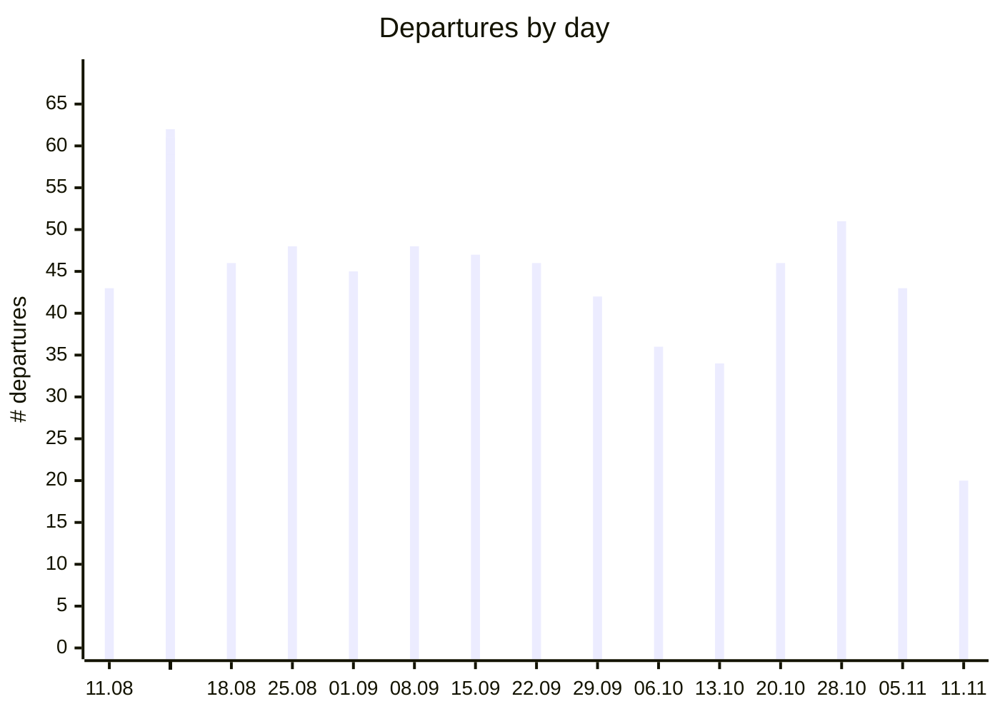
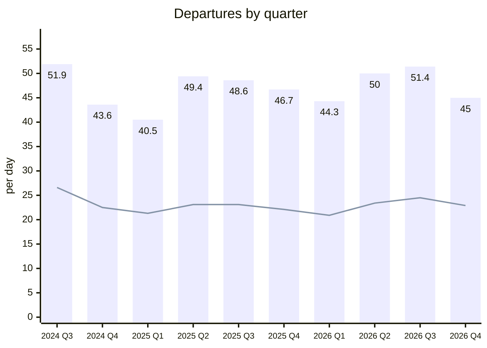

# tll-airport-departures

Tracking departures from Tallinn Airport. Data and graphs are updated daily.

## Flights in the terminal

| Hour | 11 Nov | Flights | | 12 Nov | Flights |
| --- | --- | ---: | --- | --- | ---: |
| 04:00 | 11 Nov | 1 | | 12 Nov | 5 |
| 05:00 | 11 Nov | 0 | | 12 Nov | 11 |
| 06:00 | 11 Nov | 0 | | 12 Nov | 9 |
| 07:00 | 11 Nov | 0 | | 12 Nov | 7 |
| 08:00 | 11 Nov | 0 | | 12 Nov | 4 |
| 09:00 | 11 Nov | 0 | | 12 Nov | 5 |
| 10:00 | 11 Nov | 0 | | 12 Nov | 5 |
| 11:00 | 11 Nov | 0 | | 12 Nov | 5 |
| 12:00 | 11 Nov | 4 | | 12 Nov | 4 |
| 13:00 | 11 Nov | 6 | | 12 Nov | 6 |
| 14:00 | 11 Nov | 8 | | 12 Nov | 5 |
| 15:00 | 11 Nov | 7 | | 12 Nov | 6 |
| 16:00 | 11 Nov | 8 | | 12 Nov | 7 |
| 17:00 | 11 Nov | 5 | | 12 Nov | 5 |
| 18:00 | 11 Nov | 4 | | 12 Nov | 3 |
| 19:00 | 11 Nov | 4 | | 12 Nov | 3 |
| 20:00 | 11 Nov | 5 | | 12 Nov | 4 |
| 21:00 | 11 Nov | 4 | | 12 Nov | 3 |
| 22:00 | 11 Nov | 1 | | 12 Nov | 1 |

Each flight is counted in the two hours before it leaves.

## When the terminal is busiest

Averages from 1 Aug 2024 through 11 Nov 2026, 767 days. Weekday and month numbers are the average of that day’s busiest hour.

05:00 is the busiest hour (10.2 flights). 22:00 is the quietest (1.9).
Friday is the busiest weekday (13.2). Saturday is the quietest (10.2).
September is the busiest month (12.7). January is the quietest (10.8).

| Hour | Avg flights | | Weekday | Avg peak | | Month | Avg peak |
| --- | ---: | --- | --- | ---: | --- | --- | ---: |
| 04:00 | 5.6 | | Monday | 12.4 | | January | 10.8 |
| 05:00 | 10.2 | | Tuesday | 12.0 | | February | 11.1 |
| 06:00 | 9.1 | | Wednesday | 11.5 | | March | 11.5 |
| 07:00 | 7.7 | | Thursday | 11.8 | | April | 11.6 |
| 08:00 | 5.2 | | Friday | 13.2 | | May | 11.9 |
| 09:00 | 5.6 | | Saturday | 10.2 | | June | 12.1 |
| 10:00 | 5.9 | | Sunday | 11.5 | | July | 12.1 |
| 11:00 | 5.3 | |  |  | | August | 12.5 |
| 12:00 | 7.4 | |  |  | | September | 12.7 |
| 13:00 | 8.2 | |  |  | | October | 12.1 |
| 14:00 | 8.9 | |  |  | | November | 11.2 |
| 15:00 | 8.8 | |  |  | | December | 11.1 |
| 16:00 | 9.3 | |  |  | |  |  |
| 17:00 | 7.0 | |  |  | |  |  |
| 18:00 | 6.1 | |  |  | |  |  |
| 19:00 | 5.1 | |  |  | |  |  |
| 20:00 | 5.0 | |  |  | |  |  |
| 21:00 | 4.3 | |  |  | |  |  |
| 22:00 | 1.9 | |  |  | |  |  |

## Trend of Daily Departures

Last 90 days. One bar per day.



## Departures by quarter

Full history. Bars are the average departures per day. The line is the average number of destinations per day.



## Unique destinations and departures

Departures to each city since 1 Aug 2024. Airports in the same city are counted together. A multi-stop flight is counted once for each city on the title. The rates are averages over that whole span, and a longer bar means more departures.

```
Helsingi                         6909   8.3/day   58.1/wk   252.8/mo  3033.1/yr  ████████████████████████
Stockholm                        3274   3.9/day   27.5/wk   119.8/mo  1437.3/yr  ███████████
Riia                             3141   3.8/day   26.4/wk   114.9/mo  1378.9/yr  ███████████
Varssavi                         2566   3.1/day   21.6/wk    93.9/mo  1126.5/yr  █████████
Frankfurt                        1962   2.4/day   16.5/wk    71.8/mo   861.3/yr  ███████
Kopenhaagen                      1690   2.0/day   14.2/wk    61.8/mo   741.9/yr  ██████
Amsterdam                        1343   1.6/day   11.3/wk    49.1/mo   589.6/yr  █████
Kardla                           1310   1.6/day   11.0/wk    47.9/mo   575.1/yr  █████
London                           1298   1.6/day   10.9/wk    47.5/mo   569.8/yr  █████
Kuressaare                       1284   1.5/day   10.8/wk    47.0/mo   563.7/yr  ████
Vilnius                          1171   1.4/day    9.9/wk    42.8/mo   514.1/yr  ████
Istanbul                          952   1.1/day    8.0/wk    34.8/mo   417.9/yr  ███
Antalya                           807   1.0/day    6.8/wk    29.5/mo   354.3/yr  ███
Munchen                           661   0.8/day    5.6/wk    24.2/mo   290.2/yr  ██
Berliin                           658   0.8/day    5.5/wk    24.1/mo   288.9/yr  ██
Oslo                              613   0.7/day    5.2/wk    22.4/mo   269.1/yr  ██
Pariis                            583   0.7/day    4.9/wk    21.3/mo   255.9/yr  ██
Zurich                            497   0.6/day    4.2/wk    18.2/mo   218.2/yr  ██
Brussel                           462   0.6/day    3.9/wk    16.9/mo   202.8/yr  ██
Milano                            389   0.5/day    3.3/wk    14.2/mo   170.8/yr  █
Barcelona                         385   0.5/day    3.2/wk    14.1/mo   169.0/yr  █
Malaga                            281   0.3/day    2.4/wk    10.3/mo   123.4/yr  █
Sharm El Sheikh                   273   0.3/day    2.3/wk    10.0/mo   119.8/yr  █
Heraklion                         246   0.3/day    2.1/wk     9.0/mo   108.0/yr  █
Dublin                            226   0.3/day    1.9/wk     8.3/mo    99.2/yr  █
Krakow                            215   0.3/day    1.8/wk     7.9/mo    94.4/yr  █
Viin                              195   0.2/day    1.6/wk     7.1/mo    85.6/yr  █
Hurghada                          184   0.2/day    1.5/wk     6.7/mo    80.8/yr  █
Budapest                          184   0.2/day    1.5/wk     6.7/mo    80.8/yr  █
Rooma                             173   0.2/day    1.5/wk     6.3/mo    75.9/yr  █
Praha                             155   0.2/day    1.3/wk     5.7/mo    68.0/yr  █
Nice                              154   0.2/day    1.3/wk     5.6/mo    67.6/yr  █
Tenerife                          133   0.2/day    1.1/wk     4.9/mo    58.4/yr  █
Gdansk                            129   0.2/day    1.1/wk     4.7/mo    56.6/yr  █
Tirana                            119   0.1/day    1.0/wk     4.4/mo    52.2/yr  █
Rhodos                            119   0.1/day    1.0/wk     4.4/mo    52.2/yr  █
Tivat                             115   0.1/day    1.0/wk     4.2/mo    50.5/yr  █
Billund                           114   0.1/day    1.0/wk     4.2/mo    50.0/yr  █
Burgas                            104   0.1/day    0.9/wk     3.8/mo    45.7/yr  █
Split                              98   0.1/day    0.8/wk     3.6/mo    43.0/yr  █
Veneetsia                          96   0.1/day    0.8/wk     3.5/mo    42.1/yr  █
Malta                              78   0.1/day    0.7/wk     2.9/mo    34.2/yr  █
Veneetsia-Treviso                  67   0.1/day    0.6/wk     2.5/mo    29.4/yr  █
Paphos                             66   0.1/day    0.6/wk     2.4/mo    29.0/yr  █
Palma De Mallorca                  65   0.1/day    0.5/wk     2.4/mo    28.5/yr  █
Gran Canaria                       60   0.1/day    0.5/wk     2.2/mo    26.3/yr  █
Dusseldorf                         56   0.1/day    0.5/wk     2.0/mo    24.6/yr  █
Hamburg                            47   0.1/day    0.4/wk     1.7/mo    20.6/yr  █
Tampere                            38   0.0/day    0.3/wk     1.4/mo    16.7/yr  █
Funchal                            37   0.0/day    0.3/wk     1.4/mo    16.2/yr  █
Enfidha                            35   0.0/day    0.3/wk     1.3/mo    15.4/yr  █
Salzburg                           27   0.0/day    0.2/wk     1.0/mo    11.9/yr  █
Genf                               26   0.0/day    0.2/wk     1.0/mo    11.4/yr  █
Dubrovnik                          21   0.0/day    0.2/wk     0.8/mo     9.2/yr  █
Kittila                            21   0.0/day    0.2/wk     0.8/mo     9.2/yr  █
Reykjavik                          20   0.0/day    0.2/wk     0.7/mo     8.8/yr  █
Bodrum                             16   0.0/day    0.1/wk     0.6/mo     7.0/yr  █
Larnaca                            16   0.0/day    0.1/wk     0.6/mo     7.0/yr  █
Ateena                             16   0.0/day    0.1/wk     0.6/mo     7.0/yr  █
Lamezia                            14   0.0/day    0.1/wk     0.5/mo     6.1/yr  █
Manchester                         11   0.0/day    0.1/wk     0.4/mo     4.8/yr  █
Madriid                            10   0.0/day    0.1/wk     0.4/mo     4.4/yr  █
Edinburgh                           8   0.0/day    0.1/wk     0.3/mo     3.5/yr  █
Birmingham                          8   0.0/day    0.1/wk     0.3/mo     3.5/yr  █
Catania                             5   0.0/day    0.0/wk     0.2/mo     2.2/yr  █
Faro                                5   0.0/day    0.0/wk     0.2/mo     2.2/yr  █
Kerkira                             4   0.0/day    0.0/wk     0.1/mo     1.8/yr  █
Visby                               4   0.0/day    0.0/wk     0.1/mo     1.8/yr  █
Goteborg                            3   0.0/day    0.0/wk     0.1/mo     1.3/yr  █
Cagliari                            2   0.0/day    0.0/wk     0.1/mo     0.9/yr  █
Leon                                2   0.0/day    0.0/wk     0.1/mo     0.9/yr  █
Tel Aviv                            2   0.0/day    0.0/wk     0.1/mo     0.9/yr  █
Bratislava                          2   0.0/day    0.0/wk     0.1/mo     0.9/yr  █
Istres Le Tube Istres Air Base      2   0.0/day    0.0/wk     0.1/mo     0.9/yr  █
Linz                                2   0.0/day    0.0/wk     0.1/mo     0.9/yr  █
Trieste                             2   0.0/day    0.0/wk     0.1/mo     0.9/yr  █
Tromso                              2   0.0/day    0.0/wk     0.1/mo     0.9/yr  █
Debrecen                            1   0.0/day    0.0/wk     0.0/mo     0.4/yr  █
Pisa                                1   0.0/day    0.0/wk     0.0/mo     0.4/yr  █
Hambantota                          1   0.0/day    0.0/wk     0.0/mo     0.4/yr  █
Bahrain                             1   0.0/day    0.0/wk     0.0/mo     0.4/yr  █
Pamplona                            1   0.0/day    0.0/wk     0.0/mo     0.4/yr  █
Szczecin-Goleniow Solidarnosc       1   0.0/day    0.0/wk     0.0/mo     0.4/yr  █
Luxembourg                          1   0.0/day    0.0/wk     0.0/mo     0.4/yr  █
Kosice                              1   0.0/day    0.0/wk     0.0/mo     0.4/yr  █
Liverpool                           1   0.0/day    0.0/wk     0.0/mo     0.4/yr  █
Bucharest                           1   0.0/day    0.0/wk     0.0/mo     0.4/yr  █
Farnborough                         1   0.0/day    0.0/wk     0.0/mo     0.4/yr  █
Malmo                               1   0.0/day    0.0/wk     0.0/mo     0.4/yr  █
RzeszowJasionka                     1   0.0/day    0.0/wk     0.0/mo     0.4/yr  █
Craiova                             1   0.0/day    0.0/wk     0.0/mo     0.4/yr  █
RAF Brize Norton                    1   0.0/day    0.0/wk     0.0/mo     0.4/yr  █
Kalamata                            1   0.0/day    0.0/wk     0.0/mo     0.4/yr  █
Bern                                1   0.0/day    0.0/wk     0.0/mo     0.4/yr  █
Akureyri                            1   0.0/day    0.0/wk     0.0/mo     0.4/yr  █
Katowice                            1   0.0/day    0.0/wk     0.0/mo     0.4/yr  █
Fort Worth                          1   0.0/day    0.0/wk     0.0/mo     0.4/yr  █
Brno                                1   0.0/day    0.0/wk     0.0/mo     0.4/yr  █
Tbilisi                             1   0.0/day    0.0/wk     0.0/mo     0.4/yr  █
Verona                              1   0.0/day    0.0/wk     0.0/mo     0.4/yr  █
Pardubice                           1   0.0/day    0.0/wk     0.0/mo     0.4/yr  █
La Rioja                            1   0.0/day    0.0/wk     0.0/mo     0.4/yr  █
Trondheim                           1   0.0/day    0.0/wk     0.0/mo     0.4/yr  █
```
