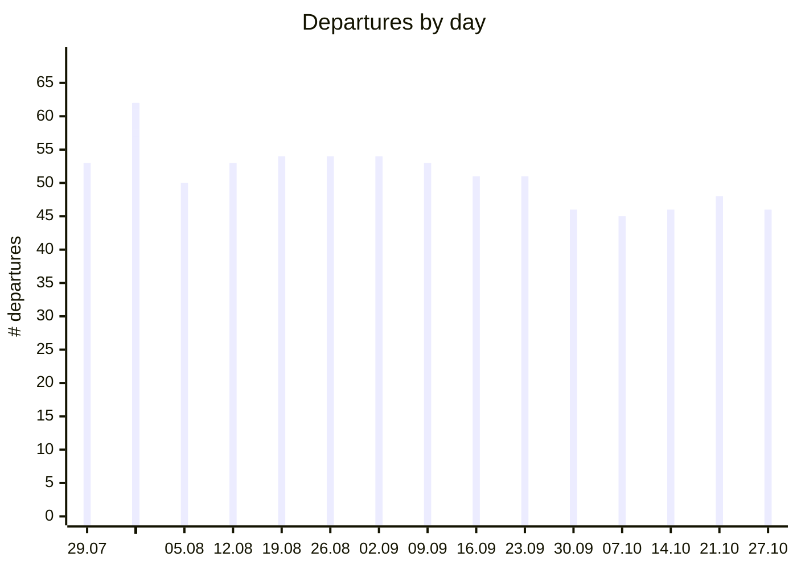
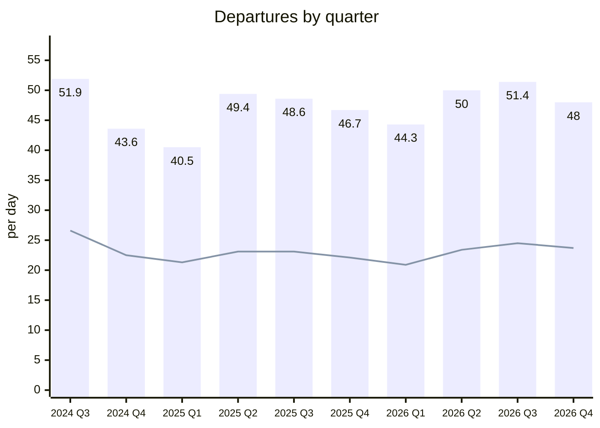

# tll-airport-departures

Tracking departures from Tallinn Airport. Data and graphs are updated daily.

## Passengers in the terminal

Hour-by-hour forecast. Quiet, steady, busy, or crowded. Each flight is spread across the two hours before departure, and holiday flights count for more.

**2026-10-28**

| Hour | Terminal | Why |
| --- | --- | --- |
| 04:00 | steady | 13 flights, 1 charter (Hurghada) |
| 05:00 | steady | 9 flights |
| 06:00 | quiet | 8 flights |
| 07:00 | quiet | 5 flights |
| 08:00 | quiet | 7 flights |
| 09:00 | quiet | 6 flights |
| 10:00 | quiet | 6 flights, 1 charter (Antalya) |
| 11:00 | quiet | 6 flights, 1 charter (Antalya) |
| 12:00 | quiet | 7 flights, 1 charter (Antalya) |
| 13:00 | quiet | 6 flights |
| 14:00 | quiet | 7 flights |
| 15:00 | quiet | 8 flights |
| 16:00 | quiet | 7 flights |
| 17:00 | quiet | 8 flights |
| 18:00 | steady | 8 flights |
| 19:00 | steady | 8 flights |
| 20:00 | quiet | 3 flights |
| 21:00 | quiet | 1 flight |
| 22:00 | quiet | no flights |

## Trend of Daily Departures

Last 90 days. One bar per day.



## Departures by quarter

Full history. Bars are the average departures per day. The line is the average number of destinations per day.



## Unique destinations and departures

Departures to each city since 1 Aug 2024. Airports in the same city are counted together. A multi-stop flight is counted once for each city on the title. The rates are averages over that whole span, and a longer bar means more departures.

```
Helsingi                         6813   8.3/day   58.4/wk   253.8/mo  3045.8/yr  ████████████████████████
Stockholm                        3235   4.0/day   27.7/wk   120.5/mo  1446.2/yr  ███████████
Riia                             3108   3.8/day   26.6/wk   115.8/mo  1389.5/yr  ███████████
Varssavi                         2526   3.1/day   21.6/wk    94.1/mo  1129.3/yr  █████████
Frankfurt                        1937   2.4/day   16.6/wk    72.2/mo   866.0/yr  ███████
Kopenhaagen                      1668   2.0/day   14.3/wk    62.1/mo   745.7/yr  ██████
Amsterdam                        1327   1.6/day   11.4/wk    49.4/mo   593.3/yr  █████
Kardla                           1292   1.6/day   11.1/wk    48.1/mo   577.6/yr  █████
London                           1283   1.6/day   11.0/wk    47.8/mo   573.6/yr  █████
Kuressaare                       1266   1.5/day   10.8/wk    47.2/mo   566.0/yr  ████
Vilnius                          1151   1.4/day    9.9/wk    42.9/mo   514.6/yr  ████
Istanbul                          935   1.1/day    8.0/wk    34.8/mo   418.0/yr  ███
Antalya                           784   1.0/day    6.7/wk    29.2/mo   350.5/yr  ███
Munchen                           656   0.8/day    5.6/wk    24.4/mo   293.3/yr  ██
Berliin                           655   0.8/day    5.6/wk    24.4/mo   292.8/yr  ██
Oslo                              605   0.7/day    5.2/wk    22.5/mo   270.5/yr  ██
Pariis                            574   0.7/day    4.9/wk    21.4/mo   256.6/yr  ██
Zurich                            495   0.6/day    4.2/wk    18.4/mo   221.3/yr  ██
Brussel                           454   0.6/day    3.9/wk    16.9/mo   203.0/yr  ██
Milano                            383   0.5/day    3.3/wk    14.3/mo   171.2/yr  █
Barcelona                         378   0.5/day    3.2/wk    14.1/mo   169.0/yr  █
Malaga                            277   0.3/day    2.4/wk    10.3/mo   123.8/yr  █
Sharm El Sheikh                   264   0.3/day    2.3/wk     9.8/mo   118.0/yr  █
Heraklion                         246   0.3/day    2.1/wk     9.2/mo   110.0/yr  █
Dublin                            219   0.3/day    1.9/wk     8.2/mo    97.9/yr  █
Krakow                            203   0.2/day    1.7/wk     7.6/mo    90.8/yr  █
Viin                              193   0.2/day    1.7/wk     7.2/mo    86.3/yr  █
Hurghada                          177   0.2/day    1.5/wk     6.6/mo    79.1/yr  █
Budapest                          176   0.2/day    1.5/wk     6.6/mo    78.7/yr  █
Rooma                             169   0.2/day    1.4/wk     6.3/mo    75.6/yr  █
Praha                             155   0.2/day    1.3/wk     5.8/mo    69.3/yr  █
Nice                              151   0.2/day    1.3/wk     5.6/mo    67.5/yr  █
Tenerife                          130   0.2/day    1.1/wk     4.8/mo    58.1/yr  █
Gdansk                            123   0.2/day    1.1/wk     4.6/mo    55.0/yr  █
Tirana                            119   0.1/day    1.0/wk     4.4/mo    53.2/yr  █
Rhodos                            119   0.1/day    1.0/wk     4.4/mo    53.2/yr  █
Tivat                             115   0.1/day    1.0/wk     4.3/mo    51.4/yr  █
Billund                           114   0.1/day    1.0/wk     4.2/mo    51.0/yr  █
Burgas                            104   0.1/day    0.9/wk     3.9/mo    46.5/yr  █
Split                              98   0.1/day    0.8/wk     3.7/mo    43.8/yr  █
Veneetsia                          93   0.1/day    0.8/wk     3.5/mo    41.6/yr  █
Malta                              76   0.1/day    0.7/wk     2.8/mo    34.0/yr  █
Veneetsia-Treviso                  67   0.1/day    0.6/wk     2.5/mo    30.0/yr  █
Paphos                             66   0.1/day    0.6/wk     2.5/mo    29.5/yr  █
Palma De Mallorca                  65   0.1/day    0.6/wk     2.4/mo    29.1/yr  █
Gran Canaria                       60   0.1/day    0.5/wk     2.2/mo    26.8/yr  █
Dusseldorf                         51   0.1/day    0.4/wk     1.9/mo    22.8/yr  █
Hamburg                            47   0.1/day    0.4/wk     1.8/mo    21.0/yr  █
Tampere                            38   0.0/day    0.3/wk     1.4/mo    17.0/yr  █
Funchal                            35   0.0/day    0.3/wk     1.3/mo    15.6/yr  █
Enfidha                            35   0.0/day    0.3/wk     1.3/mo    15.6/yr  █
Salzburg                           27   0.0/day    0.2/wk     1.0/mo    12.1/yr  █
Genf                               26   0.0/day    0.2/wk     1.0/mo    11.6/yr  █
Kittila                            21   0.0/day    0.2/wk     0.8/mo     9.4/yr  █
Dubrovnik                          21   0.0/day    0.2/wk     0.8/mo     9.4/yr  █
Reykjavik                          20   0.0/day    0.2/wk     0.7/mo     8.9/yr  █
Ateena                             16   0.0/day    0.1/wk     0.6/mo     7.2/yr  █
Larnaca                            16   0.0/day    0.1/wk     0.6/mo     7.2/yr  █
Bodrum                             16   0.0/day    0.1/wk     0.6/mo     7.2/yr  █
Lamezia                            14   0.0/day    0.1/wk     0.5/mo     6.3/yr  █
Manchester                         11   0.0/day    0.1/wk     0.4/mo     4.9/yr  █
Madriid                            10   0.0/day    0.1/wk     0.4/mo     4.5/yr  █
Edinburgh                           8   0.0/day    0.1/wk     0.3/mo     3.6/yr  █
Birmingham                          8   0.0/day    0.1/wk     0.3/mo     3.6/yr  █
Faro                                5   0.0/day    0.0/wk     0.2/mo     2.2/yr  █
Catania                             5   0.0/day    0.0/wk     0.2/mo     2.2/yr  █
Visby                               4   0.0/day    0.0/wk     0.1/mo     1.8/yr  █
Kerkira                             4   0.0/day    0.0/wk     0.1/mo     1.8/yr  █
Goteborg                            3   0.0/day    0.0/wk     0.1/mo     1.3/yr  █
Istres Le Tube Istres Air Base      2   0.0/day    0.0/wk     0.1/mo     0.9/yr  █
Leon                                2   0.0/day    0.0/wk     0.1/mo     0.9/yr  █
Linz                                2   0.0/day    0.0/wk     0.1/mo     0.9/yr  █
Cagliari                            2   0.0/day    0.0/wk     0.1/mo     0.9/yr  █
Tromso                              2   0.0/day    0.0/wk     0.1/mo     0.9/yr  █
Tel Aviv                            2   0.0/day    0.0/wk     0.1/mo     0.9/yr  █
Trieste                             2   0.0/day    0.0/wk     0.1/mo     0.9/yr  █
Bratislava                          2   0.0/day    0.0/wk     0.1/mo     0.9/yr  █
La Rioja                            1   0.0/day    0.0/wk     0.0/mo     0.4/yr  █
Liverpool                           1   0.0/day    0.0/wk     0.0/mo     0.4/yr  █
RAF Brize Norton                    1   0.0/day    0.0/wk     0.0/mo     0.4/yr  █
Brno                                1   0.0/day    0.0/wk     0.0/mo     0.4/yr  █
Pamplona                            1   0.0/day    0.0/wk     0.0/mo     0.4/yr  █
Craiova                             1   0.0/day    0.0/wk     0.0/mo     0.4/yr  █
Kalamata                            1   0.0/day    0.0/wk     0.0/mo     0.4/yr  █
Malmo                               1   0.0/day    0.0/wk     0.0/mo     0.4/yr  █
Verona                              1   0.0/day    0.0/wk     0.0/mo     0.4/yr  █
Fort Worth                          1   0.0/day    0.0/wk     0.0/mo     0.4/yr  █
Hambantota                          1   0.0/day    0.0/wk     0.0/mo     0.4/yr  █
Bahrain                             1   0.0/day    0.0/wk     0.0/mo     0.4/yr  █
Kosice                              1   0.0/day    0.0/wk     0.0/mo     0.4/yr  █
Farnborough                         1   0.0/day    0.0/wk     0.0/mo     0.4/yr  █
Luxembourg                          1   0.0/day    0.0/wk     0.0/mo     0.4/yr  █
Tbilisi                             1   0.0/day    0.0/wk     0.0/mo     0.4/yr  █
Pardubice                           1   0.0/day    0.0/wk     0.0/mo     0.4/yr  █
Trondheim                           1   0.0/day    0.0/wk     0.0/mo     0.4/yr  █
Katowice                            1   0.0/day    0.0/wk     0.0/mo     0.4/yr  █
Bucharest                           1   0.0/day    0.0/wk     0.0/mo     0.4/yr  █
Pisa                                1   0.0/day    0.0/wk     0.0/mo     0.4/yr  █
Szczecin-Goleniow Solidarnosc       1   0.0/day    0.0/wk     0.0/mo     0.4/yr  █
Akureyri                            1   0.0/day    0.0/wk     0.0/mo     0.4/yr  █
RzeszowJasionka                     1   0.0/day    0.0/wk     0.0/mo     0.4/yr  █
Debrecen                            1   0.0/day    0.0/wk     0.0/mo     0.4/yr  █
Bern                                1   0.0/day    0.0/wk     0.0/mo     0.4/yr  █
```
